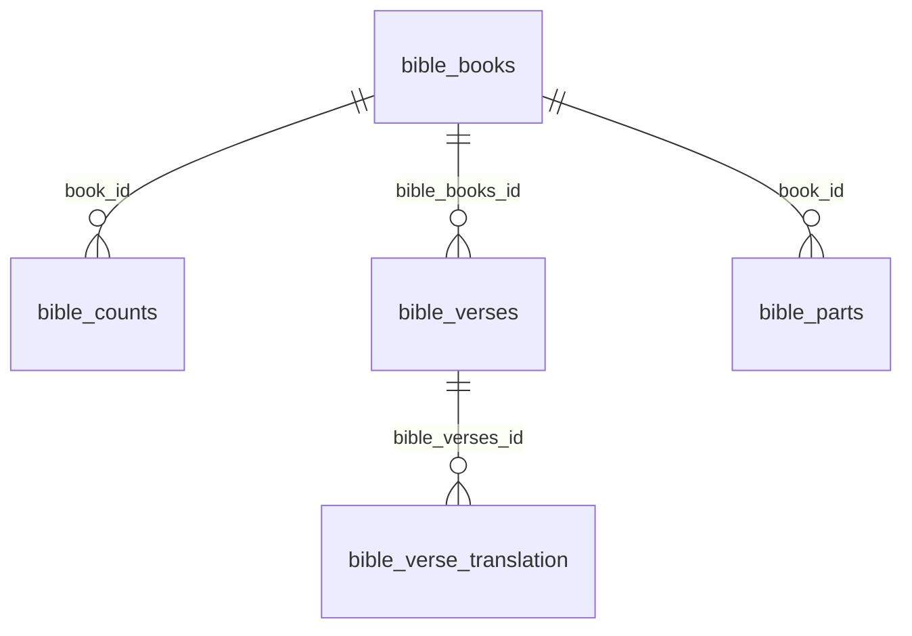

# Bible Database Schema Documentation

## Overview

This document describes the database schema for the Bible API project. The database contains Hungarian Bible translations with structured data for books, chapters, verses, and translations.

## Database Information

- **Database Type**: Cloudflare D1 (SQLite)
- **Database Name**: `SEARCH_DB`

## Table Structure

### 1. `bible_books` - Bible Book Information
**Purpose**: Contains metadata for each book of the Bible in Hungarian.

| Column | Type | Description | Example |
|--------|------|-------------|---------|
| `id` | INTEGER PRIMARY KEY | Unique book identifier | 1, 2, 3... |
| `name` | TEXT | Full Hungarian book name | "Mózes első könyve" |
| `short_name` | TEXT | Abbreviated Hungarian name | "1Móz" |
| `number` | INTEGER | Book number/order | 101, 102, 103... |
| `search_name` | TEXT | Search-friendly name | "1.Mózes" |
| `abbrev` | TEXT | Standard Bible abbreviation | "GEN", "EXO", "LEV" |

**Sample Data**:
- Genesis: `id=1, name="Mózes első könyve", short_name="1Móz", abbrev="GEN"`
- Exodus: `id=2, name="Mózes második könyve", short_name="2Móz", abbrev="EXO"`

**Row Count**: 66 books (Old Testament + New Testament)

---

### 2. `bible_counts` - Chapter and Verse Statistics
**Purpose**: Contains verse counts for each chapter in each book.

| Column | Type | Description | Example |
|--------|------|-------------|---------|
| `book_id` | INTEGER | References `bible_books.id` | 1, 2, 3... |
| `book_name` | TEXT | Full book name (denormalized) | "Mózes első könyve" |
| `book_short_name` | TEXT | Short book name (denormalized) | "1Móz" |
| `chapter` | INTEGER | Chapter number | 1, 2, 3... |
| `verse_count` | INTEGER | Number of verses in chapter | 31, 25, 24... |
| `UF` | INTEGER | Verse count (UF translation) | 31, 25, 24... |
| `KG` | INTEGER | Verse count (KG translation) | 31, 25, 24... |
| `KNB` | INTEGER | Verse count (KNB translation) | 31, 25, 24... |

**Sample Data**:
- Genesis 1: `book_id=1, chapter=1, verse_count=31`
- Genesis 2: `book_id=1, chapter=2, verse_count=25`

**Row Count**: 1,190 chapter entries

---

### 3. `bible_verses` - Verse References
**Purpose**: Contains individual verse references and identifiers.

| Column | Type | Description | Example |
|--------|------|-------------|---------|
| `id` | INTEGER PRIMARY KEY | Unique verse identifier | 1, 2, 3... |
| `bible_books_id` | INTEGER | References `bible_books.id` | 1, 2, 3... |
| `chapter` | INTEGER | Chapter number | 1, 2, 3... |
| `verse` | INTEGER | Verse number | 1, 2, 3... |
| `code` | TEXT | Verse code identifier | "GEN001001" |
| `code_string` | TEXT | String version of code | "GEN001001" |

**Row Count**: 31,529 verses

---

### 4. `bible_verse_translation` - Verse Text Content
**Purpose**: Contains the actual text content of verses in different translations.

| Column | Type | Description | Example |
|--------|------|-------------|---------|
| `id` | INTEGER PRIMARY KEY | Unique translation identifier | 1, 2, 3... |
| `bible_verses_id` | INTEGER | References `bible_verses.id` | 1, 2, 3... |
| `text` | TEXT | The actual verse text | "Kezdetben teremté Isten..." |
| `trans` | INTEGER | Translation identifier | 1, 2, 3... |

**Row Count**: 93,422 verse translations

---

### 5. `bible` - Bible Range References
**Purpose**: Contains range references for Bible passages.

| Column | Type | Description | Example |
|--------|------|-------------|---------|
| `id` | INTEGER PRIMARY KEY | Unique range identifier | 1, 2, 3... |
| `chapter_start` | INTEGER | Starting chapter | 1, 2, 3... |
| `verse_start` | INTEGER | Starting verse | 1, 2, 3... |
| `chapter_end` | INTEGER | Ending chapter | 1, 2, 3... |
| `verse_end` | INTEGER | Ending verse | 1, 2, 3... |

**Row Count**: 0 (currently empty)

---

### 6. `bible_parts` - Bible Part Segments
**Purpose**: Contains segmented parts of Bible passages.

| Column | Type | Description | Example |
|--------|------|-------------|---------|
| `id` | INTEGER PRIMARY KEY | Unique part identifier | 1, 2, 3... |
| `book_id` | INTEGER | References `bible_books.id` | 1, 2, 3... |
| `voice_id` | INTEGER | Voice/speaker identifier | 1, 2, 3... |
| `chapter_start` | INTEGER | Starting chapter | 1, 2, 3... |
| `verse_start` | INTEGER | Starting verse | 1, 2, 3... |
| `verse_start_sentence` | TEXT | Starting sentence marker | "a", "b" |
| `chapter_end` | INTEGER | Ending chapter | 1, 2, 3... |
| `verse_end` | INTEGER | Ending verse | 1, 2, 3... |
| `verse_end_sentence` | TEXT | Ending sentence marker | "a", "b", "c" |
| `type` | INTEGER | Part type identifier | 1, 2, 3... |

**Row Count**: 0 (currently empty)

---

## Relationships



## Indexes

Defined in `migrations/0001_add_verse_lookup_indexes.sql`:

- `idx_bible_verses_book_chapter_verse` on `bible_verses (bible_books_id, chapter, verse)`
- `idx_bible_verse_translation_verse_trans` on `bible_verse_translation (bible_verses_id, trans)`

Both are applied to the production database (migration recorded 2026-10-26). They let a verse lookup read only the matching rows (typically under 25) instead of scanning both tables (~125k rows per query).

To apply migrations to a new or local database:

```bash
wrangler d1 migrations apply search_translations --remote   # or --local
```

Building these indexes counts as roughly one written row per table row (~125k in total), so on the D1 free plan (100k rows written per day) a fresh database needs them created on separate days.

### `d1_migrations`

Created by wrangler to track which files in `migrations/` have been applied (`id`, `name`, `applied_at`). Not used by the API.

## Data Status

- `bible_books` - 66 rows
- `bible_counts` - 1,190 rows
- `bible_verses` - 31,529 rows
- `bible_verse_translation` - 93,422 rows
- `bible` - 0 rows
- `bible_parts` - 0 rows
- `d1_migrations` - 1 row (wrangler migration tracking)

## Hungarian Bible Translations

The database contains Hungarian Bible translations with the following identifiers:

### Translations
- **UF** - Újfordítású Biblia (New Translation) - `trans=0` - Default translation
- **RUF** - Revideált Új Fordítás (Revised New Translation) - `trans=1`

### Historical Translations (Reference in schema)
- **KG** - Káldi György translation (legacy reference in `bible_counts`)
- **KNB** - Káldi-Neovulgata Biblia (legacy reference in `bible_counts`)

## Usage Examples

### Get All Books
```sql
SELECT * FROM bible_books ORDER BY number;
```

### Get Chapter Counts for a Book
```sql
SELECT chapter, verse_count 
FROM bible_counts 
WHERE book_id = 1 
ORDER BY chapter;
```

### Get Book Information by Abbreviation
```sql
SELECT * FROM bible_books WHERE abbrev = 'GEN';
```

### Get Verses with Specific Translation
```sql
-- Get Genesis 1:1 in RUF translation (trans=1)
SELECT b.name, b.abbrev, v.chapter, v.verse, t.text
FROM bible_verses v
JOIN bible_books b ON v.bible_books_id = b.id
JOIN bible_verse_translation t ON v.id = t.bible_verses_id
WHERE b.abbrev = 'GEN' AND v.chapter = 1 AND v.verse = 1 AND t.trans = 1;

-- Get all translations for a verse
SELECT b.abbrev, v.chapter, v.verse, t.trans, t.text
FROM bible_verses v
JOIN bible_books b ON v.bible_books_id = b.id
JOIN bible_verse_translation t ON v.id = t.bible_verses_id
WHERE b.abbrev = 'GEN' AND v.chapter = 1 AND v.verse = 1
ORDER BY t.trans;
```

---

*Last Updated: 2026-10-26*
*Database Version: Cloudflare D1*
*API Translation Support: UF, RUF*


